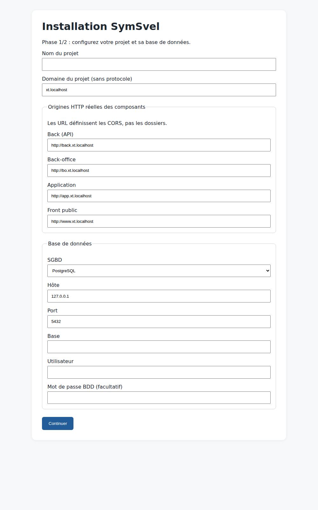
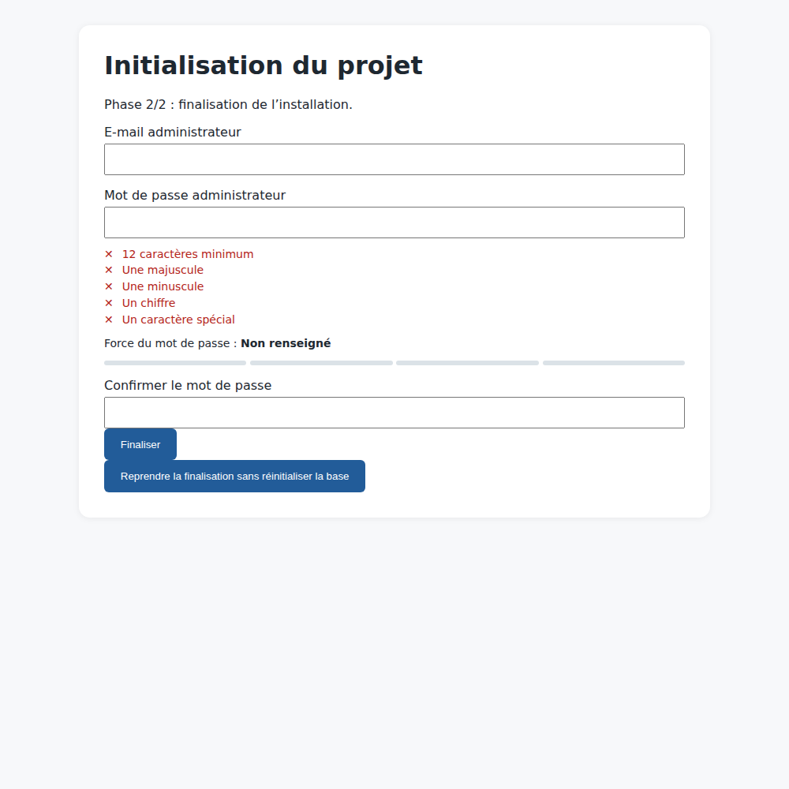

# 4. Configurer le projet en local

Le wizard s'ouvre sur une adresse 127.0.0.1 avec un port choisi par la CLI. Gardez le terminal ouvert pendant la configuration.

## Étape 1 : projet et base de données

1. Saisissez le nom du projet et son domaine local.
2. Renseignez les origines réellement utilisées par le backend et les interfaces installées (schéma, hôte et port éventuel, sans chemin).
3. Choisissez PostgreSQL, MySQL, MariaDB ou SQLite.
4. Renseignez les informations de connexion à votre serveur SQL. Pour SQLite, choisissez le chemin du fichier relatif au backend.
5. Validez. SymSvel prépare la base et exécute les migrations.

Exemple : http://api.catalogue.test pour Back, http://bo.catalogue.test pour BO, http://app.catalogue.test pour App. Utilisez les adresses correspondant à vos propres hôtes virtuels.

## Étape 2 : premier administrateur

Saisissez l'adresse e-mail, puis un mot de passe conforme aux critères affichés (au moins 12 caractères, majuscule, minuscule, chiffre et caractère spécial). Confirmez et validez.

La finalisation compile les interfaces installées. Ouvrez ensuite l'adresse du BO configurée à l'étape 1 et connectez-vous avec ce compte.

Si vous interrompez le wizard, reprenez-le depuis le workspace :

~~~bash
symsvel setup
~~~

En cas d'échec, consultez le message du wizard et le journal privé .symsvel/setup-error.log lorsqu'il est présent. Ne supprimez pas la base pour relancer une phase récupérable.

[Étape suivante : découvrir le projet](05-premiers-pas.md).
