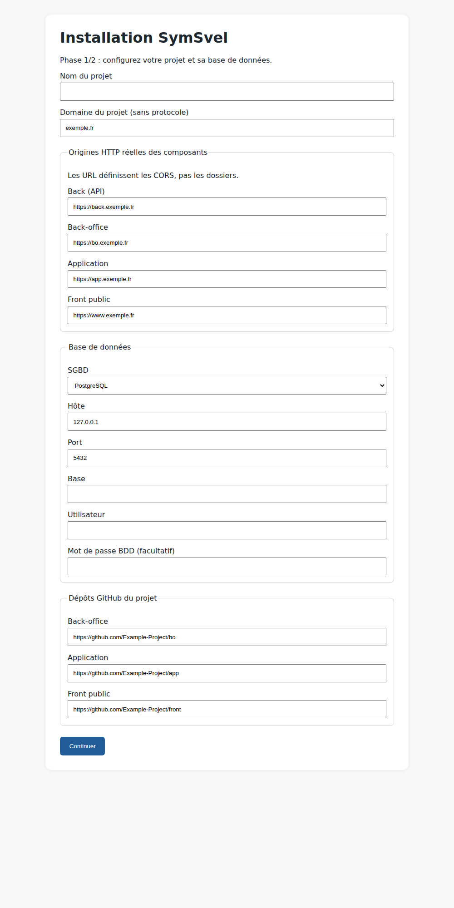
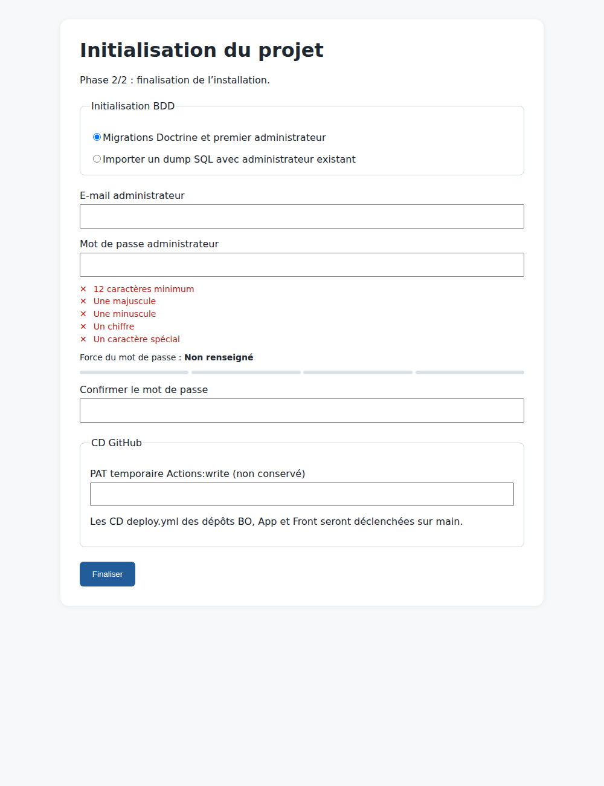

# Premier Setup en production

## 1. Installer le backend

Connectez-vous en SSH à l'hébergement PHP. Dans le dossier backend vide, clonez le dépôt de votre application :

~~~bash
git clone git@github.com:VOTRE-ORGANISATION/backend.git .
composer install
~~~

Adaptez le dépôt et configurez auparavant un accès SSH GitHub. Ne lancez pas composer install --no-dev lors de ce premier Setup : les commandes Tooling sont nécessaires.

Configurez la racine web sur public. Le compte PHP doit pouvoir écrire les fichiers de configuration privés et lancer PHP CLI 8.4. Si nécessaire, définissez SYMSVEL_PHP_CLI avec son chemin absolu.

## 2. Configurer le projet

Ouvrez https://api.example.com/prod_settings en remplaçant le domaine. Restreignez l'accès à cette route pendant la première installation (pare-feu, restriction IP ou dispositif équivalent côté hébergeur).

Renseignez le nom du projet, ses origines HTTPS, le SGBD et ses identifiants. Renseignez également les dépôts des interfaces. Le BO est obligatoire.

## 3. Initialiser la base

Choisissez l'une des possibilités proposées :

- **Migrations Doctrine** : installez une base neuve et créez le premier administrateur.
- **Importer un dump** : fournissez un fichier SQL texte compatible avec le SGBD et contenant un administrateur existant. Ne confondez pas une base de production avec une base de développement contenant des données de test. Sauvegardez les données avant tout import.

## 4. Déclencher la livraison

Utilisez un PAT GitHub fine-grained avec Actions:write limité aux dépôts d'interface concernés. Il est utilisé ponctuellement par le wizard pour lancer les CD. Il ne remplace pas les clés SSH nécessaires aux workflows.

Vérifiez les résultats GitHub Actions : une demande acceptée ne garantit pas que les fichiers sont effectivement publiés.

Une fois le Setup terminé, vérifiez /api/health, le BO, la connexion, le mail et les interfaces. La route d'installation est verrouillée après finalisation.

[Déploiement des interfaces et mises à jour](03-livraison.md).
